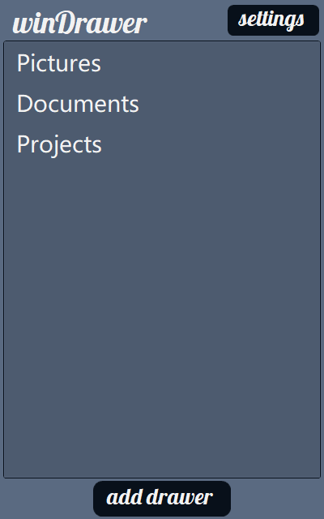
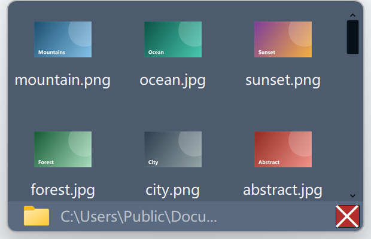
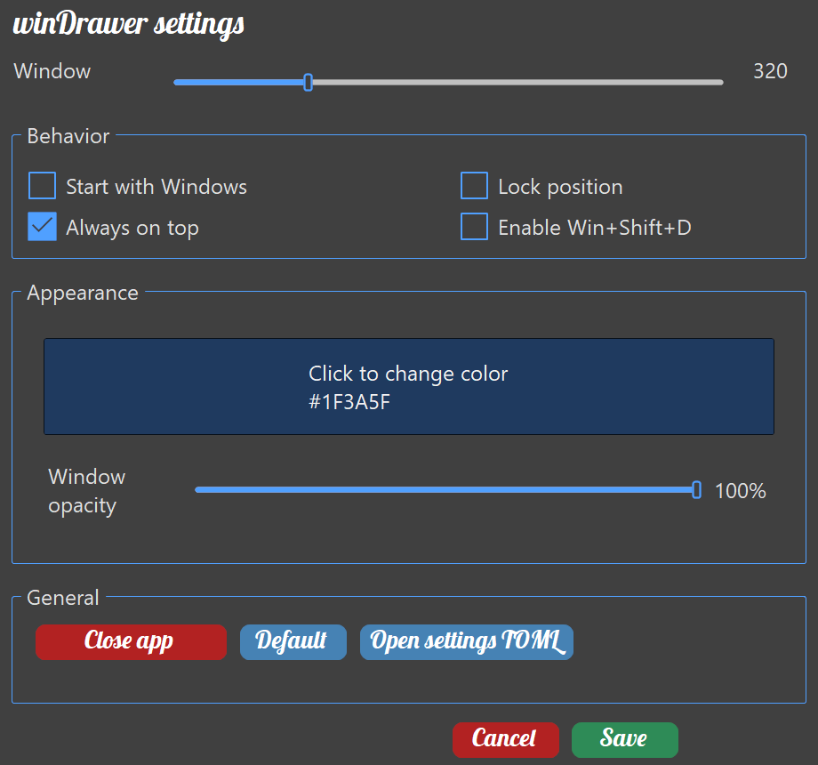

# winDrawer

winDrawer keeps frequently used folders one click away. Open a drawer to see a folder's direct children, preview images, and double-click anything to open it with Windows.

Although the visual style is quite different now, I sincerely hope that a similar functionality can be integrated into toolsets like PowerToys.



## What it does

- **Folder drawers** – Keep a list of folders and open any of them in a compact drawer.
- **Image thumbnails** – JPG/JPEG/PNG files appear as list thumbnails; other items use Windows Shell icons.
- **Windows-native actions** – Double-click an item to open it with its default Windows behavior.
- **Hover highlight** – The item under the pointer gets a soft highlight, so the entry you are about to open stands out.
- **Drag and drop** – Drag items to Explorer, or drop files/folders into a drawer; Windows performs the move/copy.
- **Large folders are capped** – A drawer shows at most `max_drawer_items` entries (default 200); larger folders show a status instead, and the folder path can still open them in Explorer.
- **Tray control** – Use the tray icon or `Win+Shift+D` to show/hide the main window and current drawer.
- **Window lock** – Locking hides the add/settings buttons and disables dragging; settings stay reachable from the tray menu or by right-clicking the title text.

## Quick start

Requirements: Windows and the .NET 10 SDK.

```powershell
dotnet build .\src\winDrawer.csproj
dotnet run --project .\src\winDrawer.csproj
```

## Drawer



A drawer lists only the selected folder's direct children; it does not recurse or navigate into subfolders. Items default to newest first and can be switched to oldest first or name order from the right-click menu, which also offers **Refresh** (F5). The folder icon and path at the bottom open the folder in File Explorer.

## Settings



Choose the theme color through the Windows color dialog, adjust window opacity, set the main window height, and toggle login startup, window lock, always-on-top, and the global shortcut. Window lock hides the header buttons; settings remain available from the tray menu or a right-click on the title text. The header link opens the project page on GitHub.

## Configuration

Settings are stored at:

```text
%USERPROFILE%\.config\winDrawer\Drawer-settings.toml
```

On first start (when that file does not exist) winDrawer writes the default template and creates two drawers: the configuration directory itself and a `demoDrawer` folder with sample files (a text file, the app logo image, and a folder to open). Existing settings are never overwritten, and sample files are only created when missing.

The drawer limit can be changed directly in the TOML file:

```toml
[startup]
max_drawer_items = 200
```

The value is clamped to 1–10000; missing or invalid values fall back to 200. It is not exposed in the settings window. See [CONFIGURATION_FORMAT.md](docs/CONFIGURATION_FORMAT.md) for every field.

Transition animations share a single frame interval that can be tuned in the same file:

```toml
[startup]
animation_frame_ms = 15
```

`0` disables every transition, values are clamped to 0–50 ms, and anything between 1 and 7 is raised to 8. A larger interval means fewer, cheaper frames; a smaller one looks smoother. It is not exposed in the settings window either.

## Build a single file

```powershell
dotnet publish .\src\winDrawer.csproj -c Release
```

```powershell
dotnet publish .\src\winDrawer.csproj `
  -c Release `
  -r win-x64 `
  --self-contained false `
  -p:PublishSingleFile=true `
  -p:IncludeAllContentForSelfExtract=true `
  -o .\publish\win-x64
```

The single-file build is written under the project's `bin\Release\...\publish` folder.

## Project layout

- `src/Forms/` – Main window, drawer window, settings windows.
- `src/Drawers/` – Direct-child enumeration, sorting, item limits, icons/thumbnails, drop planning.
- `src/Configuration/` – TOML model and persistence.
- `src/Controls/` – Native WinForms controls and project-local controls: `DrawerListBox`, `ThemedScrollBar`, `ColorPreviewPanel`, `BehaviorCheckBoxGroup`, `ScrollableListView`, and UI helpers.
- `src/Theming/` – Theme palette, branding font, Shell icons.
- `src/Infrastructure/` – Logging, tray, startup registration, hotkey, Shell file operations.
- `docs/` – [Documentation index](docs/INDEX.md), configuration format, white paper, screenshots, and [development history](docs/development-history/README.md) for completed stage plans, reviews, and migration records.

Screenshots use demo folders and images. They were captured before the native-control migration and before the main window was narrowed; the drawer and settings screenshots are still representative, but the main-window screenshot still shows the old footer **add drawer** button, which is now an icon button in the header.

## UI implementation

winDrawer uses native WinForms controls plus a few small project-local controls. It no longer depends on SunnyUI. Buttons are native flat buttons with theme colours; `Cancel`/`Save` use the full branding size, while other buttons use a slightly smaller size to avoid clipping the Lobster font. The main window is deliberately narrow: its header carries the `winDrawer` wordmark plus **add drawer** and **settings** icon buttons (Segoe MDL2 Assets glyphs, falling back to Segoe UI Symbol), and the drawer list fills the rest of the window. Short transitions (drawer slide-in, fade-in, scrollbar widening, list hover highlight) follow the Windows **animation effects** setting and never change the configured opacity or window position. The drawer content scrollbar is a thin custom overlay; the native ListView scrollbar is intentionally retained for scrolling but clipped outside the visible host area.

## License

This project is distributed under the MIT License.
