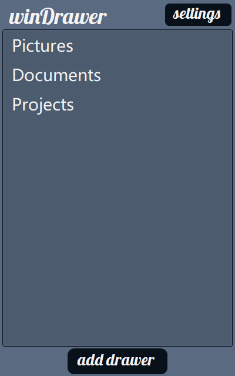
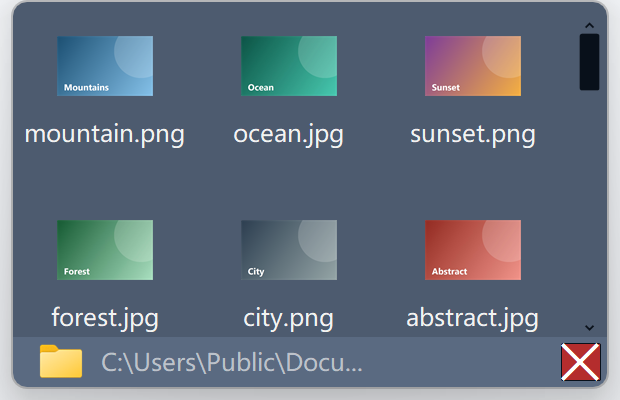
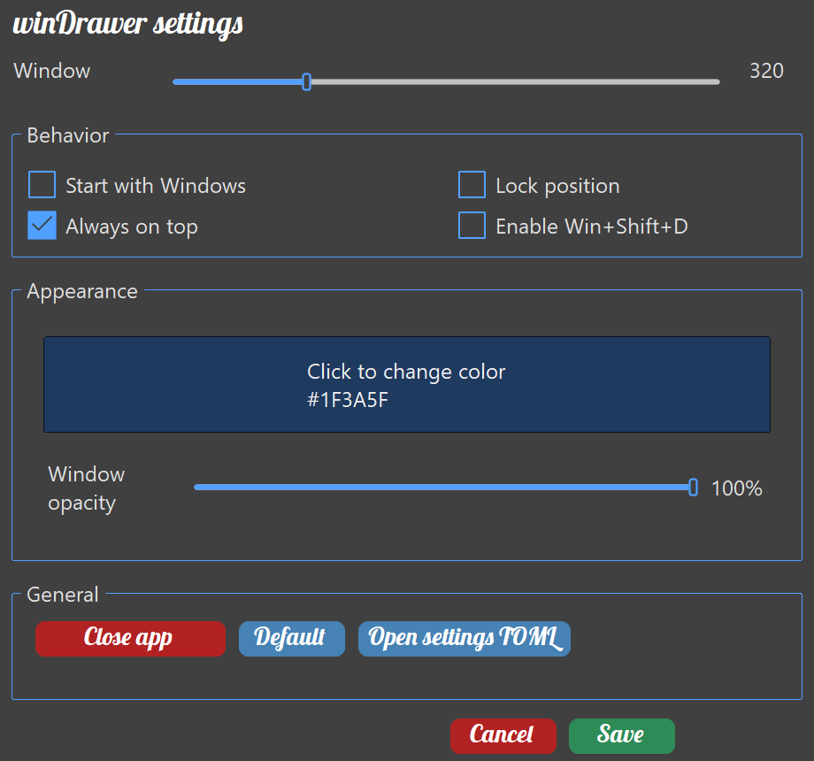

# winDrawer

winDrawer keeps frequently used folders one click away. Open a drawer to see a folder's direct children, preview images, and double-click anything to open it with Windows.

Although the visual style is quite different now, I sincerely hope that a similar functionality can be integrated into toolsets like PowerToys.



## Download

Two single-file builds are attached to every release:

- `winDrawer-v<version>-win-x64-standalone.exe` – self-contained; includes the .NET runtime, so it runs without anything else installed.
- `winDrawer-v<version>-win-x64-framework-dependent.exe` – smaller; requires the [.NET 10 Desktop Runtime](https://dotnet.microsoft.com/download/dotnet/10.0).

> **The executables are not digitally signed.** This project does not have a code-signing certificate, so Windows SmartScreen or your antivirus may warn that the publisher is unknown. Only continue if the file came from this repository's Releases page and its SHA256 hash matches the one listed in `SHA256SUMS.txt` there. Choose **More info → Run anyway** after verifying the download.

## What it does

- **Folder drawers** – Keep a list of folders and open any of them in a compact drawer.
- **Image thumbnails** – JPG/JPEG/PNG files appear as list thumbnails; other items use Windows Shell icons.
- **Windows-native actions** – Double-click an item to open it with its default Windows behavior.
- **Hover highlight** – The item under the pointer gets a soft highlight, so the entry you are about to open stands out.
- **Drag and drop** – Drag items to Explorer, or drop files/folders into a drawer; Windows performs the move/copy.
- **Large folders are capped** – A drawer shows at most `max_drawer_items` entries (default 200); larger folders show a status instead, and the folder path can still open them in Explorer.
- **Tray control** – Use the tray icon or `Win+Shift+D` to show/hide the main window and current drawer.
- **Window lock** – Locking hides the add/settings buttons and disables dragging; settings stay reachable from the tray menu or by right-clicking the title text.

## Quick start

Requirements: Windows and the .NET 10 SDK.

```powershell
dotnet build .\src\winDrawer.csproj
dotnet run --project .\src\winDrawer.csproj
```

## Drawer



A drawer lists only the selected folder's direct children; it does not recurse or navigate into subfolders. Items default to newest first and can be switched to oldest first or name order from the right-click menu, which also offers **Refresh** (F5). The folder icon and path at the bottom open the folder in File Explorer.

## Settings



Choose the theme color through the Windows color dialog, adjust window opacity, set the main window height, and toggle login startup, window lock, always-on-top, and the global shortcut. Window lock hides the header buttons; settings remain available from the tray menu or a right-click on the title text. The header link opens the project page on GitHub. The running version is shown in the lower-left corner of the panel.

## Configuration

Settings are stored at:

```text
%USERPROFILE%\.config\winDrawer\Drawer-settings.toml
```

On first start (when that file does not exist) winDrawer writes the default template and creates two drawers: the configuration directory itself and a `demoDrawer` folder with sample files (a text file, the app logo image, and a folder to open). Existing settings are never overwritten, and sample files are only created when missing.

The drawer limit can be changed directly in the TOML file:

```toml
[startup]
max_drawer_items = 200
```

The value is clamped to 1–10000; missing or invalid values fall back to 200. It is not exposed in the settings window. See [CONFIGURATION_FORMAT.md](docs/CONFIGURATION_FORMAT.md) for every field.

Transition animations share a single frame interval that can be tuned in the same file:

```toml
[startup]
animation_frame_ms = 15
```

`0` disables every transition, values are clamped to 0–50 ms, and anything between 1 and 7 is raised to 8. A larger interval means fewer, cheaper frames; a smaller one looks smoother. It is not exposed in the settings window either.

## Build a single file

A local framework-dependent single-file build (requires the .NET 10 Desktop Runtime when run):

```powershell
dotnet publish .\src\winDrawer.csproj `
  -c Release `
  -p:PublishSingleFile=true `
  -p:IncludeAllContentForSelfExtract=true
```

The build is written under the project's `bin\Release\...\publish` folder.

The release pipeline also publishes a standalone single file, which runs without an installed .NET runtime:

```powershell
dotnet publish .\src\winDrawer.csproj `
  -c Release `
  -r win-x64 `
  --self-contained true `
  -p:PublishSingleFile=true `
  -p:IncludeNativeLibrariesForSelfExtract=true `
  -p:EnableCompressionInSingleFile=true `
  -o .\publish\win-x64-standalone
```

## Versioning and releases

Versions use the `yy.M.patch` format, for example `26.11.1`: the last two digits of the year, the month without a leading zero, and a release counter that restarts every month. The version is defined by `<Version>` in `src/winDrawer.csproj`, and the running value appears in the lower-left corner of the settings panel.

[`.github/workflows/release.yml`](.github/workflows/release.yml) publishes a release automatically on every push to `main`; it can also be started manually from the Actions tab, optionally with an exact version. For each run it:

1. Computes the next version from the existing `v*` tags (`26.11.1`, `26.11.2`, ... within the same month) using [`scripts/Get-NextWinDrawerVersion.ps1`](scripts/Get-NextWinDrawerVersion.ps1).
2. Publishes two single-file `win-x64` executables: standalone (bundled runtime) and framework-dependent (requires the .NET 10 Desktop Runtime).
3. Creates the GitHub release with generated notes, both executables, and `SHA256SUMS.txt`.

Add `[skip release]` to a commit message to skip the automatic release for that push. The workflow needs the repository's default `GITHUB_TOKEN` with `contents: write` permission. See [docs/RELEASE.md](docs/RELEASE.md) for the release checklist and local verification steps.

## Project layout

- `src/Forms/` – Main window, drawer window, settings windows.
- `src/Drawers/` – Direct-child enumeration, sorting, item limits, icons/thumbnails, drop planning.
- `src/Configuration/` – TOML model and persistence.
- `src/Controls/` – Native WinForms controls and project-local controls: `DrawerListBox`, `CompositedPanel`, `ThemedScrollBar`, `ColorPreviewPanel`, `BehaviorCheckBoxGroup`, `ScrollableListView`, and UI helpers.
- `src/Theming/` – Theme palette, text contrast, branding font, Shell icons.
- `src/Infrastructure/` – Logging, tray, startup registration, hotkey, Shell file operations, window animations, application version.
- `scripts/` – Release helpers; `Get-NextWinDrawerVersion.ps1` computes the next `yy.M.patch` version.
- `docs/` – [Documentation index](docs/INDEX.md), configuration format, white paper, screenshots, and [development history](docs/development-history/README.md) for completed stage plans, reviews, and migration records.

Screenshots use demo folders and images. They were captured before the native-control migration and before the main window was narrowed; the drawer and settings screenshots are still representative, but the main-window screenshot still shows the old footer **add drawer** button, which is now an icon button in the header.

## UI implementation

winDrawer uses native WinForms controls plus a few small project-local controls. It no longer depends on SunnyUI. Buttons are native flat buttons with theme colours; `Cancel`/`Save` use the full branding size, while other buttons use a slightly smaller size to avoid clipping the Lobster font. The main window is deliberately narrow: its header carries the `winDrawer` wordmark plus **add drawer** and **settings** icon buttons (Segoe MDL2 Assets glyphs, falling back to Segoe UI Symbol), and the drawer list fills the rest of the window. Short transitions (drawer slide-in, fade-in, scrollbar widening, list hover highlight) follow the Windows **animation effects** setting and never change the configured opacity or window position. The drawer content scrollbar is a thin custom overlay; the native ListView scrollbar is intentionally retained for scrolling but clipped outside the visible host area.

## License

This project is distributed under the MIT License.
